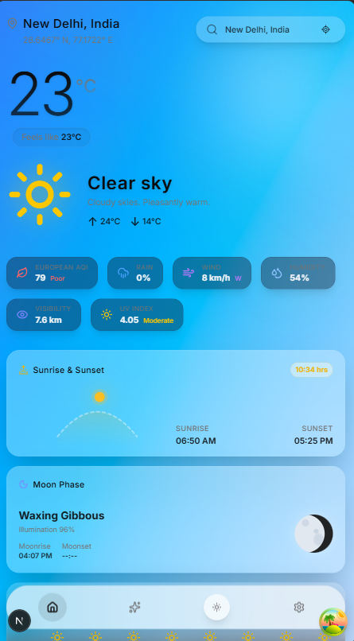
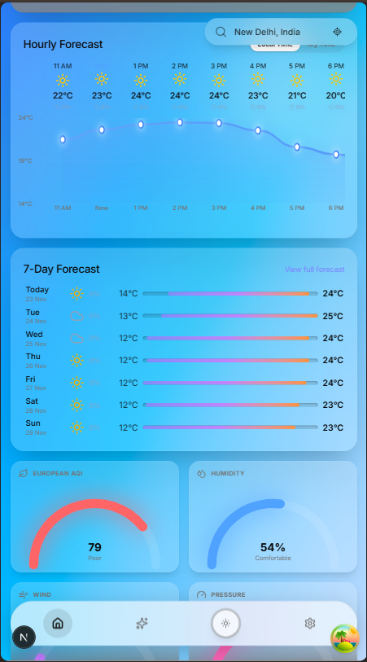
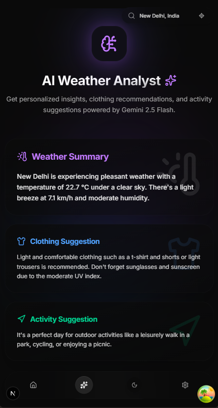
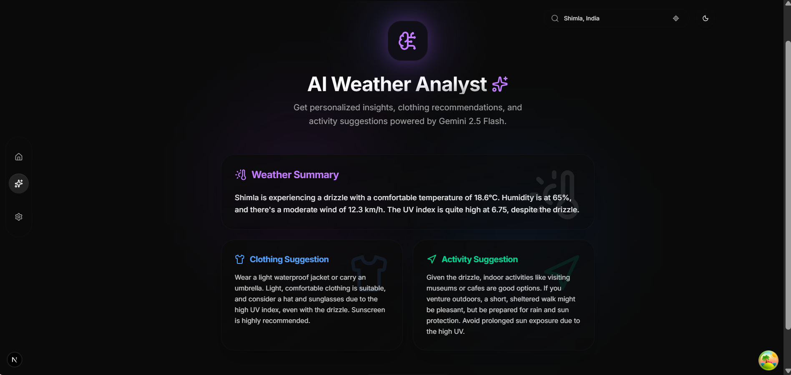

# WeatherWiseAI

**Weather dashboard and AI Weather Analyst** · Explore the next few hours, compare the days ahead and turn the current weather into clothing and activity suggestions. The Next.js dashboard brings forecasts, air quality and astronomy together for the selected city.

[](https://github.com/Rohit-0310/WeatherWiseAI-Web/releases/tag/v1.0.0)
[](package.json)
[](https://github.com/Rohit-0310/WeatherWiseAI-Web/actions/workflows/ci.yml)
[](LICENSE)
[](https://github.com/Rohit-0310/WeatherWiseAI-Web)
[](https://github.com/Rohit-0310/WeatherWiseAI-Web/forks)

**Release status** · [v1.0.0 pre-release](https://github.com/Rohit-0310/WeatherWiseAI-Web/releases/tag/v1.0.0)

[Screenshots](#screenshots) · [Local setup](#local-setup) · [API integration](#api-integration) · [Architecture](#architecture) · [Testing](#testing) · [Deployment](#deployment) · [Contributing](#releases-and-contributing)

## WeatherWiseAI Repositories

| Repository | Role |
| --- | --- |
| [WeatherWiseAI-API](https://github.com/Rohit-0310/WeatherWiseAI-API) | ASP.NET Core service for location lookup, weather data, astronomy and Gemini generation |
| [WeatherWiseAI-Web](https://github.com/Rohit-0310/WeatherWiseAI-Web) (this repository) | Next.js dashboard for exploring forecasts and requesting recommendations |

The browser calls the API directly over HTTPS. The API handles the upstream provider requests and keeps the Gemini credential on the server.

## Screenshots

These dashboard captures follow one city from current conditions through the forecast to generated advice. Select a capture to read it at full size.

| Current weather and astronomy | Hourly and daily forecasts | AI weather, clothing and activity suggestions |
| --- | --- | --- |
| [](docs/screenshots/dashboard-mobile.png) | [](docs/screenshots/forecast-mobile.png) | [](docs/screenshots/ai-analyst-mobile.png) |

<details>
<summary>View the desktop AI Weather Analyst</summary>

[](docs/screenshots/ai-analyst-desktop.png)

</details>

## Screens and features

| Screen | What you can do |
| --- | --- |
| Dashboard (`/`) | See current and feels-like temperatures, wind, humidity, UV and European AQI. Explore the hourly temperature chart, daily forecast, sunrise and sunset times, and moon phase. Animated backgrounds reflect weather conditions. |
| AI Weather Analyst (`/ai-summary`) | Generate or regenerate a weather summary, clothing recommendation and activity suggestion from the selected city's weather. The page shows generation progress and offers a retry after failure. |
| Shared navigation and settings | Search for a city or use device location with browser permission. Switch themes and save unit and time preferences. Desktop uses a sidebar and mobile uses bottom navigation. |

## Local setup

Install Git, Node.js 24 and npm. Start the companion API with its HTTPS launch profile and trust the development certificate on the browser machine. The backend README includes the restore, certificate and launch commands. [API setup](https://github.com/Rohit-0310/WeatherWiseAI-API)

```sh
git clone https://github.com/Rohit-0310/WeatherWiseAI-Web.git
cd WeatherWiseAI-Web
npm ci
npm run dev
```

Open the [local dashboard](http://localhost:3000), search for a city and select a result. Open [AI Weather Analyst](http://localhost:3000/ai-summary) and generate an insight once the API has a Gemini key.

## API integration

The shared Axios client defaults to `https://localhost:7008/api/v1`. For another API, set the public base URL in a frontend `.env.local` file. This example shows the local default.

```dotenv
NEXT_PUBLIC_WEATHER_API_URL=https://localhost:7008/api/v1
```

Include `/api/v1` in that value. Restart the development server after changing it. A production build embeds the value in the browser bundle. On the API, set `Cors__AllowedOrigins__0` to the exact **web origin** (for example, `http://localhost:3000` during development). Supply `Gemini__ApiKey` only to the API process.

| Browser action | Request under `/api/v1` | What the client reads |
| --- | --- | --- |
| Search or use device location | GET `/Location/search` or `/Location/reverse` | Array of city matches or one resolved location in `data` |
| View the dashboard | GET `/Weather/current`, `/Weather/hourly`, `/Weather/forecast`, `/Weather/astronomy` | Weather, forecast and astronomy objects in `data` |
| Generate AI advice | POST `/AiSummary` with `location`, `temperature`, `condition`, `humidity`, `wind` and `uvIndex` strings | Top-level `summary`, `clothing` and `activity` strings |

These calls require no caller credentials. On a failed forecast the user can retry the panel. An AI failure shows a message on the Analyst screen. For request examples, cache lifetimes and the different server error shapes, see the [API integration guide](docs/API_INTEGRATION.md).

## Architecture

Next.js 16 App Router and React 19 compose the screens in TypeScript. Feature services call the shared Axios client. TanStack Query caches weather and location reads, Zustand persists the selected location and preferences, and the Analyst page keeps the generated result in component state. Tailwind CSS 4, shadcn/ui with Base UI, Lucide, Framer Motion and next-themes supply the interface. Inter is bundled locally.

| Directory | Responsibility |
| --- | --- |
| `src/app/` | Dashboard and Analyst routes, root layout, providers and global styles |
| `src/features/weather/` | Weather services and hooks, forecast panels, astronomy cards and weather effects |
| `src/features/location/` | City search, device lookup and location services |
| `src/shared/` | Axios client, persisted store, API types, navigation, settings and formatting |
| `src/components/ui/` | Reusable UI primitives |
| `tests/` | AQI unit tests and desktop/mobile Playwright tests |
| `docs/` | Architecture, design system, API integration and contributor guides |

Trace [a city selection through the hourly forecast](docs/ARCHITECTURE.md#from-city-selection-to-an-hourly-forecast) or [AI generation through the three suggestion cards](docs/ARCHITECTURE.md#from-generate-to-three-suggestion-cards).

## Testing

Run the following from the frontend repository after `npm ci`.

```sh
npm run lint
npm exec -- tsc --noEmit
npm test
npm run build
npx playwright install chromium
npm run test:browser
```

`npm test` checks the European AQI bands. Playwright starts the production build on port 3100 and uses intercepted API responses for desktop and mobile browser checks. The CI workflow also runs `npm audit --audit-level=high`. [Development guide](docs/DEVELOPMENT_GUIDE.md)

## Deployment

On a Node.js 24 host, install dependencies, set `NEXT_PUBLIC_WEATHER_API_URL` to the browser-reachable HTTPS API base, then build and start the application.

```sh
npm ci
npm run build
npm start
```

Configure the matching origin in the API CORS allowlist. From a browser on the deployed site, search for a city, load a forecast and generate an AI recommendation to check the full path. [Deployment guide](docs/DEPLOYMENT.md)

## Releases and contributing

- [v1.0.0 pre-release](https://github.com/Rohit-0310/WeatherWiseAI-Web/releases/tag/v1.0.0) · [Release history](https://github.com/Rohit-0310/WeatherWiseAI-Web/releases) · [Changelog](docs/CHANGELOG.md)
- [Contributing](CONTRIBUTING.md) · [Security policy](SECURITY.md) · [Roadmap](docs/ROADMAP.md) · [Documentation index](docs/README.md)

The project is distributed under the [MIT License](LICENSE). The bundled Inter font has its own [Open Font License](public/licenses/Inter-OFL.txt).
